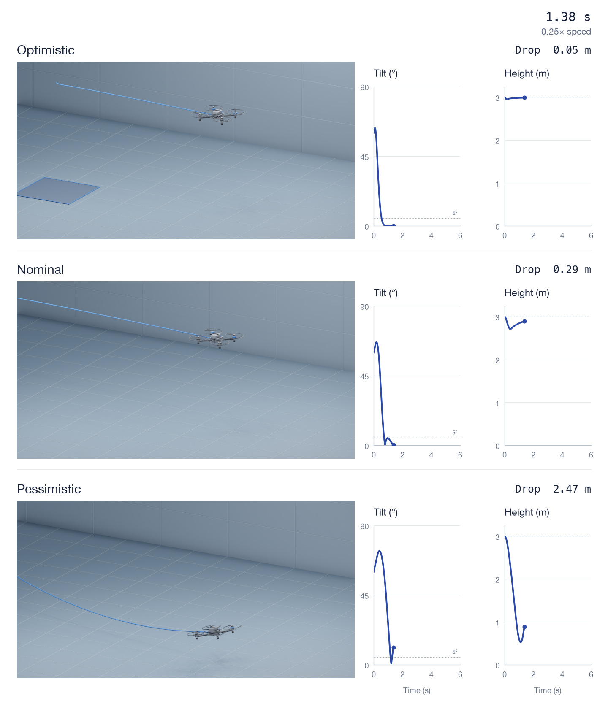

# Recovery replay

The [video](../Figures/recovery-physical-replay.mp4) shows the historical parameter
cases with motor-level allocation, rotor-speed response, and full translation.
The current optimistic case uses the historical nominal aircraft; the current
nominal case uses the historical pessimistic aircraft. The new pessimistic case
adds slow angular-rate feedback and slower motor response to that same aircraft.
The [executed results](../Data/recovery-video/results.json) contain altitude loss,
attitude/vertical settling, horizontal motion, the motor-response sensitivity
runs, and integration-step convergence. The original envelope stays unchanged.



## Model

[The generator](../Analysis/recovery_video.py) imports the existing parameter
factories, attitude/altitude gains and controller from
[the historical simulation](../Analysis/sim_release_recovery.py). The new
allocator solves the full healthy-quad wrench map. It scales an infeasible
differential force uniformly and shifts collective to fit the rotor limits.
Thrust and all three moments therefore come from the same four motor forces.
The allocator's roll and pitch authority was swept against the mixer bound
that scenario C of the Monte Carlo clips to; the
[envelope record](../Data/recovery-video/allocator-envelope.json), written by
`python -m Analysis.allocator_envelope`, shows it never exceeds that bound and
equals it on the roll and pitch axes at every collective. The two results share
one roll/pitch authority model.

Rotor speed follows an exact first-order step between commands. Rotor force is
proportional to squared normalized speed. Mid-interval motor forces drive rigid
body translation and rotation. The legacy activation dead time is retained;
the new motor response begins after activation. The code keeps gravity,
quadratic translational drag and gyroscopic coupling.
The new pessimistic case filters angular-rate feedback with a first-order lag;
attitude and translational feedback remain ideal. The other two cases retain
ideal angular-rate feedback.

The [settings](../Data/recovery-video/settings.json) pin the source revision,
initial conditions, integration step, playback timing and motor assumptions.
The response constants are borrowed from the linked PX4 Gazebo X500 model as
simulation reference values. Separate sensitivity runs vary motor response
around each displayed case. The shared arm estimate comes from the
existing mixer convention. No X500 mass, thrust coefficient or geometry is mixed
into the historical aircraft parameters.

## Scenario selection

The [search record](../Data/recovery-video/scenario-search.json) retains all
executed candidates, including ground contact and unsuccessful settling. The
owner requested a more oscillatory case that still recovers, so the displayed
pessimistic case was selected after observing those outcomes. It illustrates a
possible model response and provides no estimate of recovery probability.
Settings contain the selected filter and motor-response assumptions. The search
can be reproduced with `python tools/recovery_video/search.py`.

In addition to the earlier brief settling threshold, the result file reports
when attitude, angular rate, vertical speed and altitude error meet their bounds
and remain there through the end of the replay. This is attitude/altitude
recovery; horizontal motion continues because there is no position controller.

## Reading the video

The blue trace follows the logged centre of mass. All cases use the same world
scale, camera orientation and constant playback speed. Faint arcs trace recent
motor-centre orientations, recentered on the current centre of mass. They make
rotation visible without adding a disturbance or changing the attitude. The
camera follows horizontal travel after the initial movement within the frame;
camera height stays fixed.
Floor motion and the departing release pad show that travel. Graphs use the
same logged samples. Neither position nor attitude is amplified or eased.

The generic airframe is enlarged equally for visibility. Display scale and the
orientation-trail window live in the settings file. It is an illustrative
glyph, not CAD or a collision envelope. Blade animation follows each motor's
normalized speed at a readable display rate; it does not show physical RPM.
The removed header/footer text and "Recovered" badge stay absent.

## Limits

These are estimated-aircraft simulations, with unmeasured inertia, propulsion,
drag, geometry and response parameters. The motor model has no electrical or
battery dynamics; the run has no wind, measurement noise or estimator delay
apart from the retained activation delay and selected angular-rate filter.
Ground contact uses centre height. This replay is neither a PX4 flight-stack run nor hardware validation. It does not
advance the component-measurement gates in [ROADMAP.md](../ROADMAP.md).

## Reproduce

Run from the repository root with the analysis dependencies installed:

```sh
python -m Analysis.recovery_video
python -m unittest Analysis.tests.test_recovery_video -v
python tools/recovery_video/prepare.py
blender --background --python tools/recovery_video/render.py
python tools/recovery_video/compose.py
```

Rendering additionally needs Blender with the EEVEE API used by the script
(tested with Blender 3.2.2), Pillow and FFmpeg. Use `-- --preview` after the Blender
command and `--preview` after the compositor for selected frames. Intermediate
frames stay in the ignored `.video-build/` directory. Copy a generated composite
frame to the preview image path if regenerating that thumbnail.

The tests independently check feasible allocation, saturation, analytical motor
steps, filtered feedback against a separate linear-filter implementation,
unpowered ballistic motion, contact termination and rejection of transient
settling as held recovery. The run also halves the integration step for every displayed case. Values and deviations are in the
result file, alongside all motor-response sensitivity outcomes.
